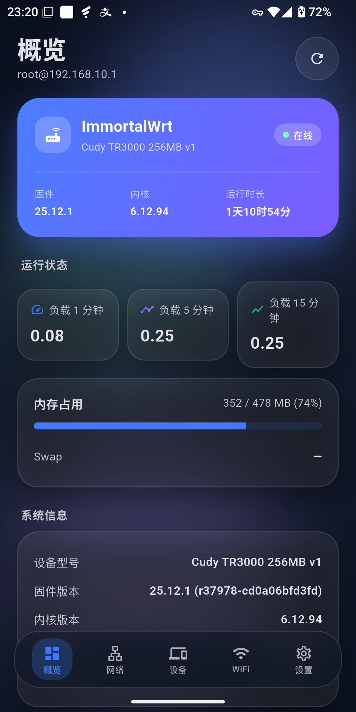
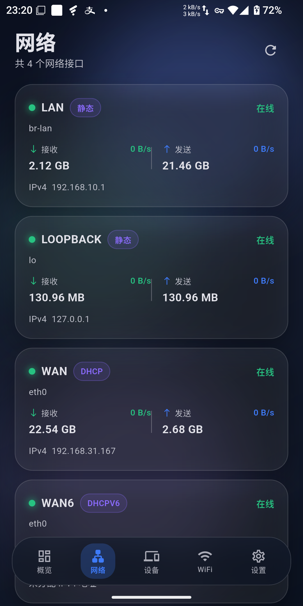
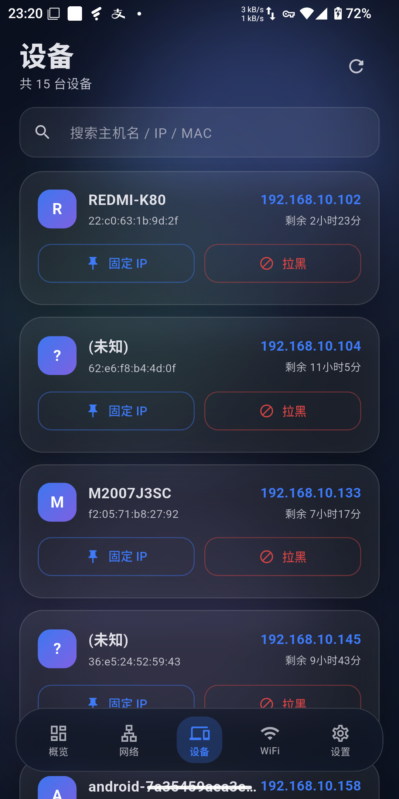
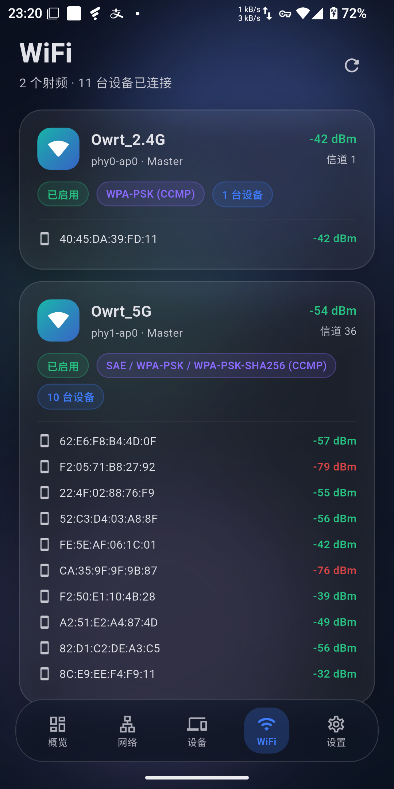
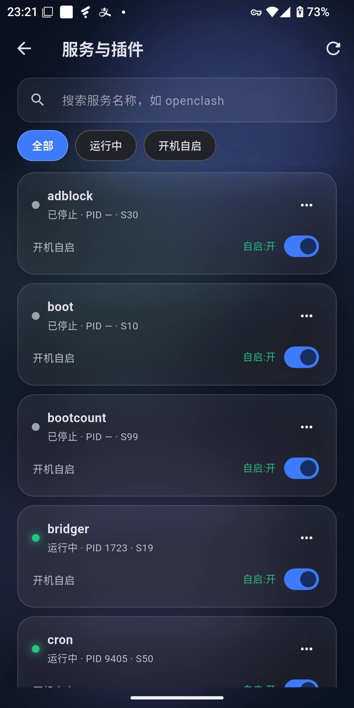
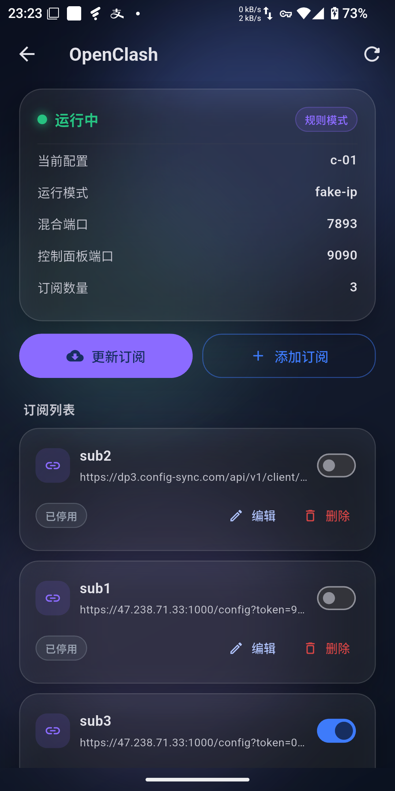

# MyOpenWrtFlutter

一款基于 Flutter 的 OpenWrt / ImmortalWrt 路由器管理应用，通过 ubus JSON-RPC 获取路由器状态并执行管理操作，支持深色与浅色主题。

## 下载

[下载最新 app-release.apk](https://github.com/xumks/MyOpenWrtFlutter/releases/latest/download/app-release.apk)

当前版本：`0.1.0+1`

## 功能

- **系统概览**：设备型号、固件与内核版本、运行时间、系统负载、内存及 Swap 使用情况
- **网络接口**：接口状态、IPv4/IPv6 地址和收发流量统计
- **设备管理**：DHCP 客户端查询、静态 IP 绑定、按 MAC 地址拉黑或解除拉黑
- **WiFi 状态**：SSID、信道、加密方式、已连接客户端及信号强度
- **服务与插件**：搜索和筛选服务，查看运行状态，管理启停、重启及开机自启
- **OpenClash**：运行状态、代理模式、订阅新增/编辑/启停/删除及订阅更新
- **连接设置**：路由器地址、端口、账号密码、HTTPS 与自签名证书支持

## 页面截图

| 系统概览 | 网络接口 | 设备管理 |
| --- | --- | --- |
|  |  |  |

| WiFi 状态 | 服务与插件 | OpenClash |
| --- | --- | --- |
|  |  |  |

## 技术栈

- Flutter / Dart
- Material Design 与毛玻璃风格界面
- `shared_preferences` 本地配置存储
- ubus JSON-RPC over HTTP

## 构建

建议使用 Flutter 3.44.8 或兼容版本，并配置 Android SDK 与 JDK 17。

```bash
flutter pub get
flutter analyze
flutter test
flutter build apk --release
```

发布版 APK 输出路径：

```text
build/app/outputs/flutter-apk/app-release.apk
```

## 使用

安装后进入「设置」，填写路由器地址、端口和登录凭据。凭据仅保存在本机应用的 SharedPreferences 中，不包含在源码仓库内。

> 管理操作会直接修改路由器配置，请确认目标路由器与操作内容后再执行。
